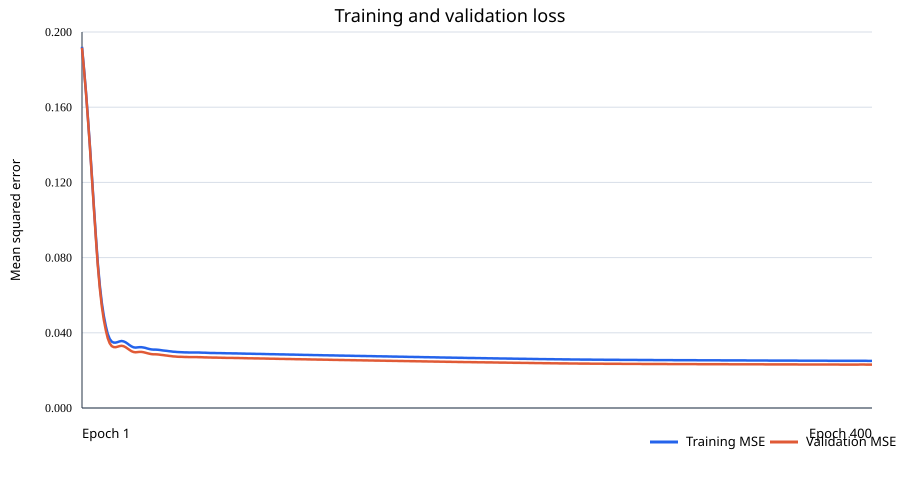

# Training the local color matcher

Grade Match can use a small supervised neural network trained locally with your examples. Training runs with Python and the exported model runs in the browser through ONNX Runtime Web. There is no remote inference API; the photos are not uploaded.

## What data is needed?

Each labeled example must have:

1. A source photo to edit.
2. A reference photo showing the look to match.
3. The desired Lightroom-style settings for editing the source photo.

Photos without desired setting labels are not enough to teach this model which edit to predict. You can create labels by editing a source photo in Lightroom, then recording the settings for the intended matched result. Use varied scenes and looks, and reserve some examples for testing rather than training.

Create a JSON Lines file with one object per line. Photo paths are relative to the manifest file:

```json
{"source":"images/source-001.jpg","reference":"images/reference-001.jpg","settings":{"temp":6,"tint":-3,"exposure":0.2,"contrast":12,"highlights":-20,"shadows":15,"whites":4,"blacks":-8,"vibrance":10,"saturation":-2,"curve":[0,28,61,128,194,228,255],"hsl":[{"h":0,"s":0,"l":0},{"h":-2,"s":8,"l":1},{"h":0,"s":0,"l":0},{"h":0,"s":0,"l":0},{"h":0,"s":0,"l":0},{"h":-5,"s":4,"l":0},{"h":0,"s":0,"l":0},{"h":0,"s":0,"l":0}],"grade":{"sh":{"hue":205,"sat":18},"mid":{"hue":30,"sat":7},"hi":{"hue":42,"sat":10}}}}
```

`hsl` entries are ordered Red, Orange, Yellow, Green, Aqua, Blue, Purple, Magenta. `curve` contains the output values for input points 0, 32, 64, 128, 192, 224, 255. The numeric limits match the settings controls in the app.

## Train and export

Use Python 3.12 or newer. From the project folder:

```powershell
py -3 -m venv .venv
.\.venv\Scripts\Activate.ps1
python -m pip install -r requirements-train.txt
python train_color_matcher.py --manifest dataset\train.jsonl
```

The trainer requires at least five labeled examples to run and keeps a validation split. Five is only a technical minimum, not enough to expect reliable color matching; use many varied examples and keep genuinely separate photos for evaluation. It prints validation metrics and exports `public/models/color_matcher.onnx`. These metrics are a smoke check, not a guarantee of perceptual quality.

### Compact synthetic training run

For a local training run without FiveK, the project can use TensorFlow's 218 MB Flower Photos example archive. Its 3,670 CC BY 2.0 flower photos cover five flower categories; this is a small, domain-limited image set, not a professional photo-grading collection. The script creates three examples per photo by applying known, locally generated settings to the source itself and using that edited copy as the reference. This makes the labels correspond to the visible source-to-reference change:

```powershell
python -m pip install -r requirements-train.txt
python prepare_synthetic_training.py
python train_color_matcher.py --manifest dataset\flower_match\train.jsonl --output public\models\color_matcher.onnx
```

The resulting manifest contains 11,010 source/reference pairs. It keeps training and validation source-photo groups separate, so a photo cannot leak between the two splits. The trainer checks that source-image groups do not cross the split. The script writes per-photo credits to `dataset\flower_match\ATTRIBUTION.txt` and extracts the full archive credit list to `dataset\flower_match\Flower_Photos_LICENSE.txt`; source images, generated pairs, and the model stay under the Git-ignored `dataset/` folder or the ignored model path.

**Important limitation:** the flower references are synthetic edits, not photographer-authored grades. The extended run described below adds portraits, landscapes, architecture, and urban photos, but its targets still come from the JavaScript solver. The neural network can imitate that algorithm but cannot learn preferences the teacher does not express. It is not trained to detect faces or reliably segment skin; its skin-related input is only a color heuristic. Review held-out metrics before relying on or sharing the model.

### Distill the JavaScript solver

To train the neural network to imitate the existing JavaScript solver, collect teacher labels for a subset of the generated pairs:

1. Start Vite with `npm run dev`.
2. In a second terminal, start the local-only label collector: `.\.venv\Scripts\python.exe export_js_teacher_labels.py --limit 1000`.
3. Open the URL printed by the collector, adding `?trainingTeacher=1&collectTeacherLabels=1` after `Grade%20Match.html` (for example, `http://localhost:5173/Grade%20Match.html?trainingTeacher=1&collectTeacherLabels=1`). Leave the browser tab open while it processes batches.
4. When the page reports that collection is complete, stop the collector with Ctrl+C and train from its output:

```powershell
.\.venv\Scripts\python.exe train_color_matcher.py --manifest dataset\flower_match\js_teacher_manifest.jsonl --output public\models\color_matcher.onnx
```

The collector binds only to localhost. Its browser training mode uses the JavaScript calculation matcher to create targets; the resulting validation score measures imitation of that matcher on held-out flower photos. It does not show that the neural network is more perceptually accurate than the teacher or that it generalizes to other types of photographs. Use a larger `--limit` to collect more pairs, allowing several minutes for each thousand images.

### Extended mixed-scene training run

The base mixed-scene dataset combines 1,000 solver-labeled flower pairs with 60 pairs from openly licensed Commons photos: 15 portraits, 15 landscapes, 15 architecture scenes, and 15 urban scenes. Each source/reference pair is based on one photo plus a synthetic edit. The label collector runs the existing JavaScript solver to produce settings for each pair; no hosted inference API is used. Keep the downloaded files and `ATTRIBUTION.tsv` together, and check the license terms before redistributing any dataset. The latest run also included 36 additional portrait pairs.

To reproduce the diverse dataset and collect its labels, first prepare the flower dataset as above, then run:

```powershell
python prepare_diverse_training.py --count-per-category 15
```

In another terminal, start Vite (`npm run dev`) and run the label collector:

```powershell
.\.venv\Scripts\python.exe export_js_teacher_labels.py --manifest dataset\diverse_match\train.jsonl --limit 60 --output dataset\diverse_match\js_teacher_manifest.jsonl
```

Open `http://localhost:5173/Grade%20Match.html?trainingTeacher=1&collectTeacherLabels=1` and leave the page open until all 60 pairs are collected. Then stop the collector with Ctrl+C. To train using both labeled manifests:

```powershell
.\.venv\Scripts\python.exe train_color_matcher.py --manifest dataset\flower_match\js_teacher_manifest.jsonl --manifest dataset\diverse_match\js_teacher_manifest.jsonl --output public\models\color_matcher.onnx
```

The trainer uses the manifests' explicit train/validation splits and rejects groups that leak across them. The 60 diverse pairs increase scene variety, but are still a small synthetic dataset; they do not establish reliable portrait, skin-tone, or cinematic-style performance.

### Portrait-focused expansion and skin-tone handling

The browser now computes six soft skin-color summary features per image: estimated candidate share, the candidate lightness 25th/50th/75th percentiles, and mean OKLab `a`/`b`. A gradual YCbCr color heuristic feeds these summaries and optionally reduces HSL/color-grading chroma changes on likely skin-colored pixels. The **Protect skin tones** checkbox enables this behavior. It is not face detection, a learned segmentation mask, or a guarantee that every skin pixel is found and every non-skin pixel is excluded; colored clothing, wood, shadows, and unusual illumination can still confuse it.

To collect more licensed portrait scenes without overwriting the existing mixed dataset:

```powershell
.\.venv\Scripts\python.exe prepare_diverse_training.py --portrait-only --count-per-category 100 --output-dir dataset\portrait_match
```

The acquisition script records source titles, attribution, and license details in `dataset\portrait_match\ATTRIBUTION.tsv`. It may return fewer than 100 photos if Commons rate-limits the request or the selected categories do not have enough eligible items. The latest run prepared 36 licensed portraits after Commons rate-limited the larger download. Run teacher labeling with a separate port while another local collector is already using the default; set `--limit` to the actual number in `train.jsonl`:

```powershell
.\.venv\Scripts\python.exe export_js_teacher_labels.py --manifest dataset\portrait_match\train.jsonl --limit 36 --port 8766 --output dataset\portrait_match\js_teacher_manifest.jsonl
```

Open the app and leave it open to collect the labels:

```text
http://localhost:5173/Grade%20Match.html?trainingTeacher=1&collectTeacherLabels=1&teacherServer=http://127.0.0.1:8766
```

Then retrain from all labeled sources:

```powershell
.\.venv\Scripts\python.exe train_color_matcher.py --manifest dataset\flower_match\js_teacher_manifest.jsonl --manifest dataset\diverse_match\js_teacher_manifest.jsonl --manifest dataset\portrait_match\js_teacher_manifest.jsonl --output public\models\color_matcher.onnx
.\.venv\Scripts\python.exe local-report\generate_training_report.py
```

More portrait photographs increase scene exposure, but solver-generated labels do not measure whether skin tones look natural. To claim high skin-segmentation precision/recall, create manually annotated skin masks across a balanced set of skin tones, lighting conditions, and camera pipelines, and evaluate against a held-out annotated set. The current model predicts global editing controls; it is not a face-aware local retoucher.

### Earlier expanded flower-heavy run

The earlier expanded run combined the existing flower, diverse-scene, and portrait manifests. Its prepared manifest and metrics are retained locally; the preparation command below now refers to the newer balanced workflow.

```powershell
.\.venv\Scripts\python.exe -u train_color_matcher.py --manifest dataset\expanded_run\combined_manifest.jsonl --output public\models\color_matcher_candidate.onnx --epochs 400 --seed 23
.\.venv\Scripts\python.exe local-report\generate_training_report.py --run-dir dataset\expanded_run
```

`prepare_expanded_manifest.py` hashes each source photo and assigns identical images to the same split, preventing duplicates from crossing train/validation. The completed run used 12,202 pairs: 11,106 synthetic known-setting pairs and 1,096 solver-labeled pairs. The sources contributed 12,010 flower pairs, 120 diverse-scene pairs, and 72 portrait pairs. The split contained 9,782 training / 2,420 validation examples across 3,006 / 752 source-image groups.

The run completed all 400 epochs and selected epoch 399. Training MSE was 0.025064; validation MSE was 0.023078. Mean normalized MAE across all 50 outputs was 0.061148, compared with 0.257654 for the run's zero-output baseline (76.3% lower error, not 76.3% accuracy). Per-slider validation MAE is in the app's slider units:

| Setting | Model MAE | Always-zero MAE |
|---|---:|---:|
| Temperature | 12.55 | 18.17 |
| Tint | 12.48 | 13.55 |
| Exposure | 0.23 | 0.63 |
| Contrast | 18.54 | 23.45 |
| Highlights | 28.13 | 29.46 |
| Shadows | 20.25 | 27.96 |
| Whites | 23.79 | 23.78 |
| Blacks | 20.04 | 20.84 |
| Vibrance | 23.92 | 27.99 |
| Saturation | 11.13 | 17.89 |

These are regression metrics over a mixed synthetic/teacher validation set, not human-perceived color quality, skin-tone accuracy, or a direct comparison with the earlier solver-only run. Validation was used to select the checkpoint, so this run does not have a separate final test set. The new ONNX remains a candidate; `public\models\color_matcher.onnx` was not replaced because this run lacks an independent human-rated comparison. The detailed report includes the data split, step-by-step training process, network diagram, dataset composition, training/validation learning curves, per-control error graph, limitations, reproducibility commands, and a short oral explanation with sample answers. It is generated as `local-report\expanded_run_MODEL_TRAINING_REPORT.docx` and `.txt`; figures are also saved individually as `expanded_run_training_metrics*.png`. Machine-readable metrics and per-epoch history are in `dataset\expanded_run\training_report.json` and `training_history.csv`; the MSE graph is `docs\training_curves.svg`. These generated datasets, models, and reports are not included in a fresh clone.

### Earlier balanced five-category candidate

To reduce the flower-heavy sampling, this earlier training manifest capped every category at the same number of distinct source-photo hashes and kept all edits of each image in one split. It retained 15 photos each of flowers, portraits, landscapes, architecture, and urban scenes (75 unique photos, 225 labeled pairs). Each category contributes 36 training pairs and 9 validation pairs; the validation pairs come from 3 distinct images per category. Multiple edits of one photo are variants, not additional independent photographs.

The external Wikimedia Commons download was rate-limited with HTTP 429 after 50 portraits and 17 landscapes; no new architecture or urban images were obtained. The existing diverse-scene set supplied those categories. The training sample was then balanced across the five labels, so the additional downloaded photos are not all represented in this 225-pair subset.

Rebuild the prepared data and train a separate candidate from PowerShell in the repository root:

```powershell
.\.venv\Scripts\python.exe prepare_diverse_training.py --count-per-category 50 --output-dir dataset\scene_expansion
.\.venv\Scripts\python.exe expand_scene_variants.py --manifest dataset\scene_expansion\train.jsonl --output dataset\scene_expansion\variants_manifest.jsonl --variants-per-photo 3 --seed 73
.\.venv\Scripts\python.exe expand_scene_variants.py --manifest dataset\diverse_match\train.jsonl --output dataset\diverse_match\variants_manifest.jsonl --variants-per-photo 3 --seed 74
.\.venv\Scripts\python.exe prepare_expanded_manifest.py --output dataset\balanced_run\combined_manifest.jsonl --additional-manifest dataset\scene_expansion\variants_manifest.jsonl --additional-manifest dataset\diverse_match\variants_manifest.jsonl --max-source-groups-per-category 50 --pairs-per-source 3 --seed 23
.\.venv\Scripts\python.exe -u train_color_matcher.py --manifest dataset\balanced_run\combined_manifest.jsonl --output public\models\color_matcher_balanced_candidate.onnx --epochs 400 --seed 23
.\.venv\Scripts\python.exe local-report\generate_training_report.py --run-dir dataset\balanced_run
```

In this run, 197 pairs used known synthetic settings and 28 used JavaScript-solver targets. The model stopped after 173 epochs under the 40-epoch patience rule and selected epoch 133. Training MSE was 0.025404; best validation MSE was 0.026984. Mean normalized MAE across 50 outputs was 0.074372, compared with 0.249826 for a zero-output baseline (70.2% lower regression error, not 70.2% accuracy).

| Validation category | Pairs / unique photos | Model normalized MAE | Zero baseline MAE |
|---|---:|---:|---:|
| Architecture | 9 / 3 | 0.073551 | 0.249809 |
| Flower | 9 / 3 | 0.065590 | 0.253083 |
| Landscape | 9 / 3 | 0.065469 | 0.249459 |
| Portrait | 9 / 3 | 0.086563 | 0.253679 |
| Urban | 9 / 3 | 0.080687 | 0.243099 |

These are regression results against generated/solver labels. Three validation photos per category are far too few to establish real-world scene quality, human preference, or skin-tone accuracy; no independent human-rated test was performed. The MAE must not be directly compared with the earlier run because the validation data differ. The balanced model remains separate as `public\models\color_matcher_balanced_candidate.onnx`; the app model was not replaced. The detailed report is `local-report\balanced_run_MODEL_TRAINING_REPORT.docx` and `.txt`; it includes the balanced dataset chart, per-category validation chart, learning curves, per-control errors, full epoch history, and an explanation of the acquisition limit. Metrics/history and run-specific graph files are in `dataset\balanced_run\`. Generated data, models, and reports are Git-ignored.

For comparison, the previous solver-only run used 1,096 pairs: 1,000 flower, 60 diverse-scene, and 36 additional portrait pairs (876 training / 220 validation groups). It completed 188 epochs and restored the best checkpoint from epoch 148. Validation MSE was 0.121745 (training MSE 0.115192). Mean normalized MAE was 0.213570, compared with 0.329885 for the zero-output baseline (35.3% lower); its per-slider validation MAE was:

| Setting | Model MAE | Always-zero MAE |
|---|---:|---:|
| Temperature | 18.64 | 23.99 |
| Tint | 17.11 | 24.81 |
| Exposure | 0.44 | 0.68 |
| Contrast | 33.68 | 38.06 |
| Highlights | 44.31 | 45.67 |
| Shadows | 32.36 | 33.23 |
| Whites | 60.44 | 65.39 |
| Blacks | 30.17 | 30.36 |
| Vibrance | 31.77 | 30.12 |
| Saturation | 19.54 | 22.00 |

Both runs measure setting prediction, **not** perceptual similarity to human grading or equivalence to the JavaScript solver. The expanded run's validation split is held out by SHA-256 source-image group. The latest training/validation curve is included below and saved as [`training_curves.svg`](./training_curves.svg) for reports.



### Full available mixed-scene run

The later all-scenes run keeps every pair available in the local flower and scene manifests instead of cutting the flower data down to match the smaller categories. It contains 12,691 labeled pairs from 3,775 unique source photos:

| Category | Labeled pairs | Unique source photos |
|---|---:|---:|
| Flower | 12,010 | 3,668 |
| Portrait | 405 | 59 |
| Landscape | 126 | 18 |
| Architecture | 75 | 15 |
| Urban | 75 | 15 |
| **Total** | **12,691** | **3,775** |

This is not 12,691 independent photographs. Several pairs are synthetic edits of the same source photo; splitting and validation are grouped by source-photo SHA-256 so edits of one photo cannot leak across train and validation. The labels comprise 11,595 synthetic known-setting pairs and 1,096 JavaScript-solver-labeled pairs. The run split 10,141 pairs from 3,019 source photos for training and 2,550 pairs from 756 source photos for validation.

Because flower examples greatly outnumber other scenes, the trainer was run with category-balanced loss. Each category contributes equal aggregate weight to training and checkpoint selection, while all available examples remain in the data. Reproduce the training and detailed report from the prepared local manifest with:

```powershell
.\.venv\Scripts\python.exe .\train_color_matcher.py --manifest dataset\all_scenes_run\combined_manifest.jsonl --output public\models\color_matcher_all_scenes_candidate.onnx --epochs 400 --seed 23 --balance-category-loss
.\.venv\Scripts\python.exe .\local-report\generate_training_report.py --run-dir dataset\all_scenes_run
```

The run requested 400 epochs and stopped at epoch 270 under the trainer's 40-epoch early-stopping patience; the lowest validation loss was at epoch 230, and that checkpoint was exported. Training MSE at the selected checkpoint was 0.028717 and validation MSE was 0.025456. The macro normalized MAE across the five categories was 0.070611, versus 0.253548 for the category-balanced zero-output baseline (72.2% lower regression error, not 72.2% accuracy).

| Validation category | Pairs / unique photos | Model normalized MAE | Zero baseline MAE |
|---|---:|---:|---:|
| Architecture | 15 / 3 | 0.064466 | 0.249207 |
| Flower | 2,406 / 734 | 0.071189 | 0.258046 |
| Landscape | 27 / 4 | 0.065611 | 0.247708 |
| Portrait | 87 / 12 | 0.072748 | 0.252779 |
| Urban | 15 / 3 | 0.079040 | 0.260002 |

The small non-flower validation groups make their per-category metrics unstable; Commons acquisition had been rate-limited after obtaining 50 additional portraits and 17 landscapes, and it yielded no new architecture or urban photos. These scores assess regression against synthetic/solver labels, **not** human-perceived color matching, skin-tone quality, or performance on an independently collected test set. No candidate was promoted automatically: `public\models\color_matcher_all_scenes_candidate.onnx` remains separate from the app's `color_matcher.onnx`.

The detailed Word and text reports are `local-report\all_scenes_run_MODEL_TRAINING_REPORT.docx` and `.txt`. The report includes dataset composition and label sources, model and training pipeline, environment, training and validation curves, per-setting and per-category errors, all 270 epoch records, limitations, and reproducibility instructions. The figures are also saved individually as `local-report\all_scenes_run_training_metrics*.png`; machine-readable metrics and epoch history are `dataset\all_scenes_run\training_report.json` and `training_history.csv`. These outputs and the prepared dataset are Git-ignored and are not present in a fresh clone.

The app evaluates the AI and calculation-based candidates and selects the one that is closer according to its image-statistics distance metric. This is a hybrid quality safeguard, not evidence that the model wins on every image or that the metric matches human judgment.

## Run the app

Build the app with:

```powershell
npm install
npm run build
```

The page and styles are bundled into `dist\Grade Match.html`; the LibRaw worker bundles remain as separate files in `dist\`. Keep the complete output directory together. Do not open the HTML using `file://` if you need RAW decoding or ONNX model loading; use the development server or preview server:

```powershell
npm run preview
```

Vite's dev and preview servers set the cross-origin isolation headers required by the RAW worker. Other static hosts must set `Cross-Origin-Opener-Policy: same-origin` and `Cross-Origin-Embedder-Policy: require-corp` and serve the full build output. The ONNX model and datasets are Git-ignored and must be supplied locally. RAW files are decoded in the browser into rendered RGB pixels; the app can edit those pixels and export PNG, but it does not edit the original RAW sensor data. The Optics control applies a manual radial distortion adjustment to the source preview and PNG export; it is not selected from camera/lens metadata, and the adjustment is not included in exported XMP presets. Automatic camera/lens profiles, chromatic-aberration correction, and Lightroom-grade RAW rendering are not implemented.

## Model outline

The input is a pair of 107-value image summaries (214 values total): luminance and OKLab quantiles, color-band measurements, shadow/midtone/highlight measurements, and six soft skin-color statistics. A small multilayer perceptron predicts 50 normalized settings, including the tone curve, HSL, and color grading. Training is supervised: it learns from the supplied labels rather than calling a hosted model.
